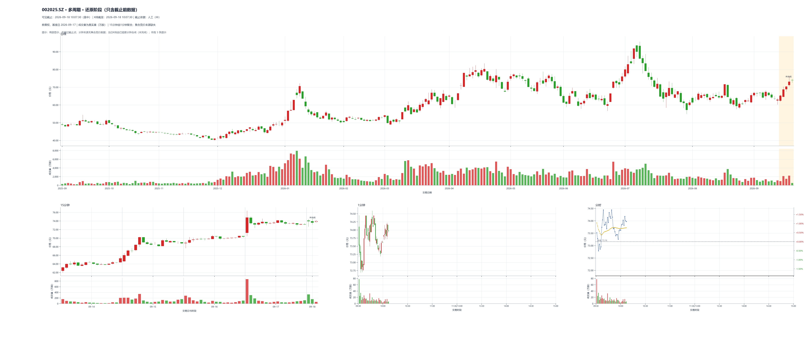

# Harry 的云聪研究与实现交接

更新：2026-10-10（JST）。基于云盘最新总控 00–09，与本地总控逐文件文本核对一致后整理。目标是让李老师与 AI 从研究问题、材料和已实现的程序继续工作。

**发布状态：已推送至 GitHub 的 HarryWu 分支。** 见 [发布与云盘快照记录](docs/PUBLISH_STATUS.md)。

我们的主线是：读懂云聪如何选出、持有和离场 → 留下可追溯的逐次提及 → 还原当时图表 → 对齐大盘与题材背景 → 归纳规则并在留出案例上测一致率 → 再研究收益和程序化。当前 **决策日志 v0 待启动**；现有转写、看图和天气工具已经提供了输入和基础设施。

## 建议阅读顺序

1. [01 目标与路线图](project_control/01_目标与路线图.md) 和 [02 当前进度](project_control/02_当前进度与下一步.md)：确定目标与下一步。
2. [我们怎样实现](docs/IMPLEMENTATION.md)：完整链路、每层输入输出、版本与运行边界。
3. [20 场直播阅读入口](transcripts/README.md)：20 × 7 份文件；试点先读 8/4–8/7。
4. [五段课程完整理解总结](research/five_courses/delivery_20260930/云聪五段视频_完整理解总结_20260930.md)、[双突破系统构建](research/learning_notes/双突破交易系统的构建.md)、[统一买卖点框架](research/learning_notes/统一买卖点执行框架-v0.1.md)：13 类买点及课程出处、量价与结构理解。
5. [07 统一提及记录规格](project_control/07_云聪提及记录_统一规格_v1.md)：后续日志唯一格式；其中 JSON 是格式示例，不能当作完成的真实决策日志。
6. [李老师源码方法对照](docs/TEACHER_METHOD_COMPARISON.md) 与 [运行步骤](docs/QUICKSTART.md)：看哪些能力已经能直接复用，哪些字段仍需适配。

## 目录地图

| 目录 | 内容与用途 |
|---|---|
| `project_control/` | 云盘读取的 16 份完整总控快照；03c–03g 保留工具背景及并行线状态，不意味着启动并行研究 |
| `docs/` | 实现解释、迁移运行说明、方法对照、旧框架与设计源文档 |
| `transcripts/ledger_2026_v0.1/` | 直播七份交付、原 ASR、review 校名/切分、词库、清单、状态和旧画面/OCR索引 |
| `research/learning_notes/` | 9 份技术分析学习笔记，含支撑阻力、趋势、反转、持续、双突破 |
| `research/five_courses/` | 五段课程的全量 ASR、169 帧复核相关材料、观点/买点结构化记录、HTML报告与最终总结 |
| `tools/chart_tool/` | 最新看图源码、契约、测试；来源 TradingAgent `5bd2261` |
| `tools/local-media-platform-2.1.0/` | 课程处理对应的 ASR、证据和精确抽帧源码快照 |
| `tools/local-media-platform-2.2.1/` | 直播运行记录对应版本的源码/测试；与当前共享工具 3.0.1 分开 |
| `tools/legacy_yuncong_scripts/` | 直播排队、股票名校正、分段、七文件导出及上传记录的历史实现 |
| `examples/` | 日线小快照、两张真实分钟组合图及侧车文件、真实直播帧与冻结/揭晓案例 |
| `infrastructure/weather/` | 天气代码、424 日派生表、解释文档和 R4 证据；来源 `d5ec591` |
| `infrastructure/market_data_reference/` | 行情统一接口说明与 1/15 分钟处理参考源码；非独立数据库工程 |
| `evidence/` | 看图 v2 部分交付与分钟启用的历史验收记录 |
| `provenance/` | 每份源文件的来源与 SHA256、20 场索引、云盘来源、大文件排除清单及整包校验表 |

## 当前完成到哪里

| 项目 | 已有 | 边界 |
|---|---|---|
| 直播文字 | 优先 20 场、140 份；原视频 36.81 小时、研究保留时段 30.82 小时 | 剩余 14 场未完成新阶段处理；225 处名称待确认；不是全量画面理解 |
| 课程学习 | 5 段、13 类买点、169 帧复核相关证据 | 原讲者自述与研究推断需区分，未形成已验证策略 |
| 看图 | 截止日线、15 分钟、1 分钟、分时；真量、固定复权锚点、先还原后揭晓 | 部分交付，可用；旧遗留见 03b，不以本次复制宣称全部修好 |
| 天气 | 2025-01-02 至 2026-09-30，共 424 日标签与可重算代码 | 当日描述工具；每日自动更新尚未启用 |
| 决策日志 | 07 格式和试点材料明确 | JSONL 抽取、批量出图入口、跨场串链、规则一致率仍待做 |

## 本次分享范围

已整理可读文本、历史处理记录、源码、设计、测试、抽帧证据和小规模图表样例。原始直播约 17.75 GB、课程原片约 3.29 GB，以及音轨、全量旧抽帧、模型、缓存、虚拟环境和行情数据库不进入 Git；详见 [范围与来源](docs/SCOPE_AND_PROVENANCE.md)。原媒体清单和已记录的哈希可用于按需定位，不能把仓库称为完整原媒体备份。

根目录原工具为李老师流程，本目录为 Harry 流程；两者的“七文件”含义不同。李老师的源码已包含原句引用与历史/计划区分；需要对接的是统一动作、股票身份、安全截止和跨视频串链。原计划里仅从 PPT 推断的部分，以本次[源码对照](docs/TEACHER_METHOD_COMPARISON.md)补充理解，原计划快照不被静默改写。

历史文档中的绝对路径、Drive ID 和旧运行参数为证据；本次可点击入口与可迁移命令以上面文档为准。GitHub 权限不自动授予 Drive 或会员视频访问权限。

## 看图输出示例

航天电器，2026-09-18 10:07:30（北京时间）截止；日线、15分钟、1分钟与分时组合，详细来源和数据视图在同目录。

本次迁移验收：140份直播交付哈希完整；新目录日线成功；50项独立测试通过；天气重算424日的350列一致。完整证据见 [迁移验收](evidence/migration_20261010/infra_validation.json)。
