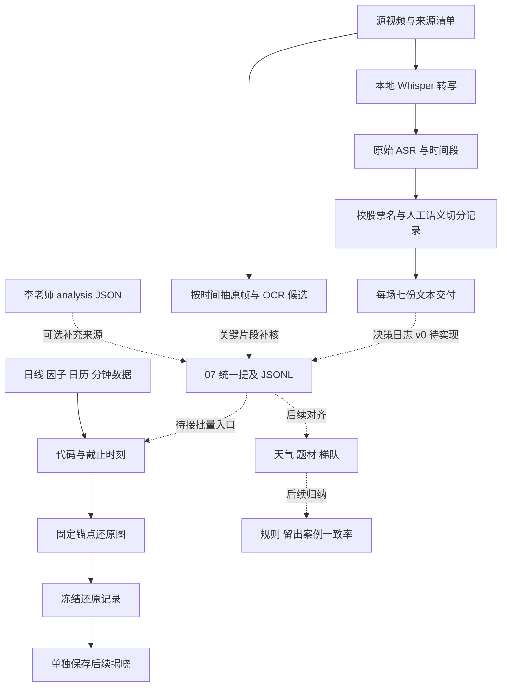

# 我们怎样把云聪材料变成可研究的记录

日期：2026-10-10（JST）。这份说明解释现有实现，以及它与计划中的决策日志如何连接。旧文档保留原样，状态以项目总控 02、03a、03b 为准。

## 一条链路，各层保留自己的证据

实线是已有组成能力；虚线连接是当前尚待实施的接口或研究步骤。没有以这次整理启动决策日志或重跑转写。

## 1. 原材料和本地转写

直播目录最初登记 54 场，标题排除明确美股/加密场次后 34 场。优先 20 场已经完成文字处理，另外 14 场仍是待办；其中 2 场旧 ASR 可核验后复用。来源、视频 ID、北京时间线索、文件路径和既有 SHA 记录在 `transcripts/ledger_2026_v0.1/streams_inventory.csv`、`source_SHA256SUMS` 及 handover 目录。

本地媒体核心负责 ffprobe/FFmpeg、16kHz 音频解码、连续分块、faster-whisper、证据导出和按 PTS 抽帧。云聪直播使用 large-v3、CUDA、float16、中文、300 秒分块、conservative VAD，并关闭逐批视觉/OCR；原音轨时间轴保留。机器识别与 Codex 阅读/校名是不同步骤。

- **课程版本 2.1.0**：从课程当时发行源码包展开，原压缩包和 wheel 随课程交付保存。
- **直播版本 2.2.1**：直播 `runtime_manifest.json` 明确记录该版本；本次找到对应历史源码包，提取核心源码、安装声明、README、测试，未把其他项目的 refine 验收资料混入。来源包 SHA 见 `provenance/media_platform_2.2.1_origin.json`。
- 共享机器上当前 3.0.1 是后续版本，本次没有用它替代历史版本。只安装所需版本到独立环境，不能把两版同时安装到一个环境。

入口、参数和模型来源见 [直播转录交接](source_documents/00_云聪视频转录交接_当前状态与继续处理.md) 和对应版本源码。模型权重没有打包；新机器还需配置本地模型、GPU运行库和 FFmpeg。历史 CPU/GPU性能并非本次重新测量。

## 2. 校名、切分与七文件

`tools/legacy_yuncong_scripts/` 保留本次批量处理的真实实现，关键入口如下。

| 脚本 | 已有职责 |
|---|---|
| `yuncong_priority_batch_20261005.py` | 冻结 20 场队列、串行 GPU、状态、分段阅读；1/9 和 8/4 复用旧结果 |
| `build_yuncong_stock_vocabulary_20261004.py` | A 股名称/别名及常见美股、ETF词库 |
| `correct_yuncong_stock_names_20261004.py` | 保留原稿，按有依据的名称规则生成校正版和变更记录 |
| `yuncong_finish_text_batch_20261005.py` | 消费逐场 `review.json`，依时间区间及标记生成七份交付 |
| `yuncong_priority_finish_all_20261005.py` | 核对批次完成和文件，生成阅读总索引及待确认名称总表 |
| `yuncong_asr_noise_recovery_20261005.py` | 对已确认的特定收尾广告越界异常另存恢复结果，不能泛化应用到任意场次 |
| `yuncong_priority_uploader_20261006.js` | 当时工具环境中的上传/回读函数片段，保留方法，不是独立可运行 Node CLI |

研究版去掉生活、八字、推广、纯闲聊及独立美股/加密问答，保留交易思路与 A 股问答。没有按固定一小时截断。保留原始稿、校正版、校名记录、切分索引和源视频偏移，所以可以返回具体片段核查。股票名纠正不能同时悄悄改年份、价格、仓位，也不能根据后来上涨猜名称。

20 场的阅读版按实际来源生成在 [transcripts/README.md](../transcripts/README.md)。特别是 8/4 正文在 `text_pilot_20261004_0804/`，不在后来批次的空壳目录；本次按 140 份逐一校验纳入。相关历史 raw ASR、review 与词库也保留，不仅分享摘要。

原20场脚本有硬编码目录和旧工具接口；下一批14场需要新任务ID、冻结输入、新输出目录及适配，不直接运行旧 `--run`。历史状态文件不是今天仍在运行的进程证明。

## 3. 从话语到一次提及：还没有实施的部分

统一对象是 07 的 `yc_mention.v1`，包括来源、视频偏移、北京时间、保守截止、股票身份、提及类型、立场、理由原句、动作与条件、画面事实、对比组、跨场链条和疑点。新选、回顾、等待、排除、放弃和失败都要保留；“曾经买过”和“现在计划买”分开。

试点输入是 8/4–8/7 四场自己的直播，不等待李老师。日志生成后，再按 07 第 6.2 节映射为看图 `RestorationRecord`。当前没有新增生产转换器，没有把总控里的示例 JSON 当真实数据。

李老师的 `analysis.json` 实际比 PPT 丰富：保留原话、cue引用、多段讨论、历史/当前/计划以及时钟区间。它可作为额外来源；详细字段映射、缺口和源码位置见 [对照文档](TEACHER_METHOD_COMPARISON.md)。当前未拿到其真实分析案例，不能声称已完成转换验证。

## 4. 看图如何实现“当时可见”

`chart_tool/data.py` 在读取后按截止过滤，价格用截止前最后已收盘日的复权因子作为固定锚点，成交量/额保留真实数。`multiperiod.py` 按结束时间组织 1 分钟，并聚合 15 分钟；`render.py`/`render_multi.py` 负责连续交易横轴、量柱、均价、昨收和未完成K线标记。图与数据视图、几何记录、像素检查和参数回执一起保存。

原1分钟CSV：241行将09:30并入09:31；240行起始时间网格整体后移一分钟。两种都不单独提供竞价，明确记录 `AUCTION_UNAVAILABLE`，逐股日核对 OHLC、量、额不合格就拒绝。这与另一个15分钟策略“整条排除额外09:30”不是同一口径。

跨机器先走 `--snapshot-dir` 的小快照路线，可独立于 TradingAgent 跑日线。原库路线实际复用只读 `offline_db_client`/sqlite3；它与总控的一般 `coreClient.data_provider` 约定有实现差异，本次如实保留，不声称已经改造。生产分钟注册表保留 Harry 的 D 盘路径，移机必须另配，不能把仅有样例图当作已复制全量分钟库。

案例先起草、按 SHA 冻结，再由 `reveal.py` 写独立结果；后续信息不回灌原记录。现行揭晓算第1/3/5/10/20日固定口径，当前短线重点为1–5日。缺数据、时钟差异、未完成分钟和除权锚点不确定性如实记录。

现有完整测试有依赖原工程绝对路径的历史夹具；历史411通过不代表任何新机器都能直接跑全套。迁移实测和可复现步骤见 [QUICKSTART](QUICKSTART.md)。遗留项继续见 03b。

## 5. 天气和行情在这里扮演什么角色

天气是提及时刻的背景标签，提供当日状态和三个读数；`market_sentiment` 可从已公开于项目内的 `mkt_raw_daily.csv`、校准JSON、日历重算，424行覆盖2025-01-02至2026-09-30。完整方法说明、数据字典、R4报告和源代码都在 `infrastructure/weather/`。日历缺失阻塞每日更新，自动运行未启用。

行情原始CSV → 1分钟Parquet → 15分钟研究层的实现参考及接口文档在 `market_data_reference/`，大库继续外置。题材发现当前暂停，未来D2只跑2025–2026；这里没有恢复其下载、扩展研究或均线实验。

## 6. 怎样继续

按照 02 的顺序制定决策日志试点任务：冻结四场输入，落实07全部提及，先核身份和时间，再接每条还原图，保留反例并留出一致率评估集。只有阻塞这项工作时才补图表或字段适配。此交接完成资料迁移和运行核验，不替代新的决策日志执行任务。
