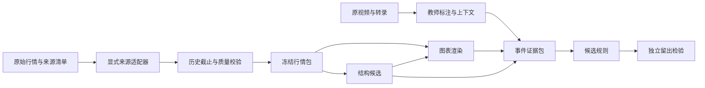

# 云聪交易理论复刻工程深化方案

版本：v0.2　日期：2026年10月7日　状态：规划稿，未启动实施

作者与验收责任：Codex。供用户审阅，并供未来实施任务使用。

本方案承接[云盘原框架 v0.1](https://drive.google.com/file/d/1e6vIN5018f_ya8ju2wSVQMNHtqrRcdYv/view)。目标是建立一套能够说明云聪当时看到了什么、为何作出判断、哪些条件仍然未知的证据与规则系统。首期完成少量事件的可重放闭环；规则忠实度与交易收益分开评估。

当前用户授权为“读取并深化，不要执行，负责规划”。本轮只读取云盘原稿、本地相关代码、目录元数据、既有报告和部分转录，新增本规划文件。未调用行情查询接口、重跑数据验收、播放或处理视频、生成行情图、运行测试、安装依赖、修改代码或数据库、启动外部模型和后台任务。下文的任务、命令、资源上限与通过条件均用于未来实施，不能当作已经完成的结果。

## 一 本版的关键决定

1. 首期目标限定为“复现观察—重建判断—留出检验”。只有完成这三步，才讨论交易效果研究。
2. 保留四层设计：行情、图表、结构、证据与规则；增加贯穿四层的历史时点和来源校验。图表与结构只接收已经校验的数据包，不自行读取数据库。
3. 优先复用原生日线、历史CSV 15分钟库和现有1分钟Parquet。1分钟仅服务盘中截断、必要核验和特定案例，不扫描全量历史。
4. 教师原画、教师标注、算法候选分别保存。算法参数、研究者解释与教师明确表达使用不同字段，不能互相代替。
5. 首期先人工校准3个事件，再完成约12至20个事件片段。新闻退出、未买到、放弃、错过和判断变化都进入样本。
6. 8月4日至7日的已读案例归入开发材料。留出片段按完整事件链隔离，不能把同一笔交易的买入用于提炼、卖出用于独立验收。
7. 已有Matplotlib绘图作为静态基线；交互图选择Plotly离线HTML作为首个候选，完成兼容性与长历史视口验证后再冻结版本。首期不增加图形算法外部依赖。
8. 新功能放在独立研究包，通过适配器接入。公共行情函数、原始数据和现有业务默认行为保持现状；必要的公共修复另列变更。
9. 本方案交付后停止。未来由用户明确启动实施；启动后在获准范围内按阶段验收推进，常规步骤无需反复征询。

## 二 事实基线与本机差异

以下使用三种证据等级：**本轮直接确认**指文件或代码读取；**既有报告记载**指已有审计与验收结果；**实施待验**指需要运行查询、图表或视频核验后才能确认。代码存在不代表功能通过验收。

### 代码和运行环境

| 项目 | 本轮确认 | 对实施的影响 |
| --- | --- | --- |
| 活动仓库 | `C:\Project Rocket\Codex\TradingAgent` | 以此工作区为定位入口 |
| 分支 | `engineering/local-data-acceptance-20260918` | 不切换分支，不自动合并上游 |
| HEAD | `3fdf6079fe15d5d0a6691202fab4fc4f18e0722b` | 只能代表提交基线 |
| 工作区 | Git状态有40条已修改记录、168条未跟踪记录；后者可能代表目录 | 必须同时记录相关文件内容哈希和本地差异，不能只记录HEAD |
| Python | `.venv/pyvenv.cfg`记载3.12.14 | 这是配置记录，运行时导入待验 |
| 包元数据 | DuckDB 1.5.5、pandas 2.3.3、NumPy 2.5.3、PyArrow 25.0.1、Matplotlib 3.11.2、SciPy 1.18.1、scikit-learn 1.9.1 | 根据本地dist-info目录确认，未做导入兼容性测试 |
| 依赖待验 | `plot/requirements.txt`要求NumPy `<3`，静态结构依赖要求SciPy、scikit-learn；未发现当前虚拟环境的Plotly dist-info目录 | 固定实测依赖集；不能把“目录存在”当作全部依赖兼容 |
| 只读入口 | 当前 `scripts/Use-LocalResearch.ps1`设置 `TRADING_AGENT_FROZEN='0'`，并有凭据环境变量读取逻辑 | 不照搬旧交接文档中的冻结启动命令；新入口显式设置冻结模式，且不读取凭据 |

本任务遵守用户提供的全局编排规则与[项目AGENTS.md](<C:/Project Rocket/AGENTS.md>)。本轮未启动任何子代理或Hermes任务。今后的批次也以Codex单一推理和验收链、确定性工具为默认方案。

### 数据资产和接口

下表中的文件和目录均已确认存在；覆盖与表结构主要复用[2026年10月6日审计](<C:/Project Rocket/reports/data_audit_20261006/audit_summary.md>)和其[结构记录](<C:/Project Rocket/reports/data_audit_20261006/out/00_schema.json>)，并非本轮重新查询数据库所得。

| 来源代号 | 实际位置与结构线索 | 接入决定 |
| --- | --- | --- |
| `daily_native` | `D:\ProjectRocketData\legacy_C_Project_Rocket\Trading Agent Database\db_cn_basic.db`；`tbl_cn_day`、`tbl_cn_adj_factor`、`tbl_cn_tradecal`、`tbl_cn_namechange`、`tbl_cn_suspend` | 原始日线与因子分开读取，再按查询锚点调整价格 |
| `m15_csv_history` | `D:\ProjectRocketData\processed\TradingAgent\fifteenMinute\fifteen_min.duckdb`；`fifteen_min_bars`及导入目录表 | 使用 `offlineDataManager/scripts/core/fifteen_min_store.py::get_fifteen_min`，显式传数据库路径 |
| `m15_tdx` | `D:\ProjectRocketData\processed\TradingAgent\db_fifteenMinute.db` | 单独适配；本轮未核验覆盖和实际schema |
| `m1_partitioned` | `D:\ProjectRocketData\processed\TradingAgent\oneMinute\parquet\schema_v2`；目录索引为相邻的 `catalog.duckdb` | 使用 `one_min_store.py::get_one_min`，强制股票与日期范围；逐股逐日读取来源清单 |
| `raw_minutes` | 原始分钟目录与 `D:\ProjectRocketData\processed\TradingAgent\staging\minutes` | 只用于指定差异的追溯，不作为日常全量扫描入口 |

日线表的现有记录字段包含 `ts_code, trade_date, open, high, low, close, pre_close, change, pct_chg, vol, amount, snap_ts`；因子表包含 `ts_code, trade_date, adj_factor, snap_ts`。历史15分钟表包含 `ts_code, name, trade_date, datetime, time_idx, open, high, low, close, vol, amount, adj_factor`。这些字段不自动证明唯一键、价格调整口径或历史可见性。

必须纳入设计的差异如下。

- `coreClient/data_provider.py::get_fifteenMin`明确路由TDX库，不读取历史CSV转换库。两个接口同名相近，不能混为一个来源。
- 日线底层 `offline_db_client.py::get_day(qfq=True)`读取该股票全部因子，按分组最后一条取基准；该SQL未按日期排序，也未限制因子截止时间。它还将成交量除以复权比例，缺失因子有填1行为。首期适配器不直接继承这些语义。
- 日K绘图默认向后扩展1个月；15分钟绘图默认向后扩展7天，并从未限定历史截止的结果取得最新因子。历史回放不能直接复用其数据加载入口。
- 日K绘图与 `build_kline_packet.py`已分别读取原始量额。前者在原始量缺失时会回填现有量，后者使用inner join和去重，仍可能隐藏缺失或冲突。新数据包在缺失时显式报错或标注。
- `build_kline_packet.py`有 `confirmed_on` 和截至日截断，但依赖上述前复权接口；`future_isolated=True`字段本身不是完整因果证明。
- 静态结构默认分析750根、上下文1250根，绘图260根；不能直接代表十年观察。现有结构说明中还有750/360/180根日线层级、对数包络和连续3根收盘确认等基线参数，均不自动成为云聪规则。
- 1分钟Parquet可能包含CSV、TDX及保留旧分区的混合数据。`tdx_with_csv_fallback`名称不足以证明某只股票来自CSV；逐日manifest的 `source_lineage.stock_codes_by_source`优先，缺失则保留 `unknown`。
- 10月6日报告记载两分钟库均覆盖4,304个交易日、2009-01-05至2026-09-18，但1分钟相对15分钟少74,669股日，部分逐股对账未完成。因此“有日期”与“该股该日完整”必须分开。
- 该报告还记载2016熔断日也出现固定240/16根。固定根数仅为格式现象，不能证明每根均为真实成交或完整交易时段。
- 原始层部分09:30和盘后记录在加工层被过滤。不能无条件用1分钟聚合量额替代原生日线，也不能把当前加工层当作全时段原始行情。
- 原框架“保留原始压缩包”的要求应解释为保留现存原始资料：既有审计记载部分已核验解压包早已删除，不能规划为仍可读取的资产。

### 文字和媒体资产

媒体基建位于 `C:\Users\HarryWu_IOKI\Documents\SharedTools\media-platform`，README记载发行版2.2.1，提供定点抽帧、实际PTS、源哈希和续跑校验。该版本记录不等于当前所有Python环境均可直接调用。

`D:\YuncongVideoAnalysis\ledger_2026_v0.1\text_priority_batch_20261005\final_acceptance.json`记载：20/20场文字完成、源时长36.8102小时、225处名称待决、`visual_processing=false`。早期 `frames_status.json`仅记载3个视频的10秒间隔抽帧完成，语义核验待做。

8月4日文字是复用试点，实际位于 `text_pilot_20261004_0804`；8月5日至7日位于批次各自子目录。不能按统一目录模板假定20场都在同一层级。已通过4份ASR manifest定位原视频，确认4个文件均存在，未在本轮重新计算视频哈希或观看画面。

## 三 复刻目标与判断边界

“复刻”分为三个独立评价对象，所有报告均须分别给出结果。

| 对象 | 要回答的问题 | 首期判断依据 |
| --- | --- | --- |
| 观察忠实度 | 是否还原了股票、周期、复权、观察跨度、结构位置 | 原帧、坐标配准、行情形态及不确定范围 |
| 判断忠实度 | 是否解释了他选择、否决或改变计划的理由 | 原话、当时画面、上下文与可观察条件 |
| 规则可迁移性 | 冻结规则能否解释未用于提炼的事件 | 隔离输入的留出结果、反例和适用边界 |

首期不以“收益好”证明复刻成功，也不以“解释了几次成功案例”证明存在普遍规则。若证据仅支持图形描述，则交付图形描述；若成交和仓位无法确认，停留在口述计划或口述操作层。

规则候选按条件来源分为：结构与位置、量价确认、题材与消息、市场环境、已有持仓、观察与执行限制。每项条件均记录是教师明确表达、画面可见、研究者推断还是未知。研究者不能把“只要突破就买”“三根收盘确认”等方便编程的条件写成教师原则。

8月5日太辰光片段出现因突发消息准备退出、填单和口述退出的连续表达；8月7日滨化片段出现低开不及预期与口述退出。这支持把“图形以外的条件”和“计划到动作的变化”纳入结构，但不证明消息真实，也不证明实际成交。来源是本地研究文本相应时间段，原视频核验仍是正式入集条件。

教师在直播中临时查阅的AI回答、新闻传闻、资金软件指标另记来源和可信度。“教师据此判断”与“该说法是事实”分别存储；无法复原的专有资金指标标为不可观测，不用成交量或其他指标静默替代。

## 四 数据和历史时点契约

### 请求与返回

拟新增 `MarketRequest -> MarketPacket`，实际代码尚不存在。请求强制包含股票、周期、起止时间、市场截止时点、来源策略和价格口径。

| 契约字段 | 规定 |
| --- | --- |
| `instrument_id` | 证券身份与交易所；代码变更通过有生效区间的映射处理，保留原始代码 |
| `timeframe` | `1d / 15m`；`1m`用于核验和已确认需要的案例 |
| `requested_range` | 期望观察范围，跨年连续；上市前区间返回“尚未上市”，不补K线 |
| `market_as_of` | 带时区的截止时刻，行情统一 `Asia/Shanghai`，不沿用本机 `Asia/Tokyo` |
| `source_policy` | 显式来源；首期默认严格单源，缺失直接报告 |
| `adjustment` | `raw`或指定锚点的前复权；记录因子来源、锚点和版本 |
| `partial_bar_policy` | 默认 `completed_only`；明确请求后才允许 `from_observed_1m` |
| `warmup_range` | 为均线、ATR等所需的前置数据；与分析窗口、显示窗口分离 |
| 返回K线 | 原始OHLC、用于形态的OHLC、实际量额、时间区间、完成状态、逐行来源 |
| 返回元数据 | 实际覆盖、缺口分类、时间与单位口径、因子状态、来源快照、查询指纹 |
| 返回质量状态 | `usable / degraded / unavailable`，附可机器识别的原因 |

缺失的数值为null；零成交量只有在来源确实记录为零时保留。相同键且数值一致可以合并并保留来源；重复键冲突不能任意 `keep='last'`。日线键为证券与交易日，分钟键为证券、周期与区间结束时刻；来源版本参与完整身份。

### 五种时间和两类可见性

每个事件至少同时记录：原视频偏移及PTS、教师判断对应的市场时刻、图上所指K线时刻、算法市场截止时刻、该解释在视频中首次出现的偏移。另记录本地采集或标注时间，用于版本审计。

**市场时间隔离**要求所有输入只依赖截止时刻及以前的行情。**历史可得性证明**还要求能够证明数据、新闻、因子和名单当时已可得到。今天下载的历史数据可能满足前者，但未必满足后者。

数据包分别记录：

- `market_cutoff_verified`：是否通过截止与未完成K线检查。
- `availability_basis`：历史采集证据、明确的可得性假设或未知。
- `revision_status`：原始历史版本、事后修订版本或未知。
- `knowledge_cutoff`：允许使用的文字、画面和外部上下文边界。

不能仅把 `trade_date <= as_of` 改成一个布尔值就声称严格历史可得。当前因子表中的 `snap_ts`也不应未经核验解释为公告时刻或生效时刻。

### 复权和单位

在确认因子定义相容后，形态价格采用同一查询锚点：`P_adjusted(t) = P_raw(t) × F(t) / F(anchor)`。因子必须正数、排序、无冲突，锚点在允许范围内。因子缺失不能填1伪装为完整；若锚点没有有效记录，返回不可用，或另建明确标为不复权的降级结果。

价格调整与实际成交量完全分开。适配器目标单位为价格“元”、成交量“股”、成交额“元”；每个来源记录原始单位和换算系数，未经证明不换算。TDX文档记载股与元，日线及CSV来源仍需通过字段说明和同股同日样本核定，不能仅依据列名判断。

历史截图中的绝对价格与数值复权图不一致时，先排查教师软件调整基准、数据供应商、坐标和时间，而不是改线来贴图。若只能复原比例形态，标明“形态可比、绝对价未校准”。形态线换算为原始触发价时保存换算因子，严禁直接混用两种价格。

### 盘中K线

适配器以区间结束时间和可得时刻筛选完整K线。时间标记规则未核实前，不默认 `datetime`就是区间结束。

以经核定为结束标记的分钟数据为例：截至10:07，10:00—10:15整根15分钟K线不可输入；若允许部分K线，只聚合当时已经完整可得的1分钟记录。若数据发布延迟未知，明确采用保守边界或“零延迟模拟”假设，不能声称精确盘中可得。

1分钟在本地加工代码中主要保留09:31—11:30、13:01—15:00。15分钟聚合按交易时段分组，上午和下午独立；集合竞价是否包含于首根需比对源记录。盘中日K由可见分钟合成时标为临时且注明竞价、盘后及缺失分钟限制。不能把当日最终日K带入盘中。

午休、停牌、临时停市、无成交、数据缺失与尚未上市使用不同状态。异常交易日的预期根数来自可验证的交易时段定义，而不是一律断言240或16。

### 跨源补充

首轮不自动拼接CSV与TDX。以后确需补充时，至少先验证重叠期的时间边界、OHLC、量额、因子与单位；保存差异表和裁决。拼接以完整、来源明确的股票日为基本单元，不能逐字段择优拼成一根看似完整的K线。

1分钟与15分钟若来自同一卖方原始资料，聚合一致只证明内部一致性，不计作独立来源验证。来源无法还原则保留未知，不通过数值相近倒推来源。

## 五 图表和结构设计

### 单向数据流



结构与渲染模块只依赖 `MarketPacket`。教师标注不作为留出片段中算法找线的输入；事后结果也不反向修改当时的数据包。

### 独立控制六个维度

周期、观察跨度、视口、分析窗口、线性或对数价格坐标、历史截止时点全部独立。另增加指标预热窗口，它只向过去扩展。

十年日K仍保存每根日K；缩放只改变显示密度。需要周K或月K时显式切换，并保留其构造规则、未完成周期标记。截断日前的完整数据包与当前视口不同，禁止算法暗中随视口变化调窗口。

首期静态输出用现有Matplotlib绘制组件，数据加载、复权和截断从新适配器传入。交互候选采用Plotly candlestick和离线HTML；官方文档确认支持交互K线、缩放平移和本地HTML输出，性能仍需本机验证。参考：[K线组件](https://plotly.com/python/candlestick-charts/)、[离线HTML](https://plotly.com/python/interactive-html-export/)。离线资源随证据包提供，不依赖CDN。

图表配置保存K线序号到时间的映射、坐标模式、视口边界、画布尺寸、价格范围和叠加对象。横轴用本次序列的稳定K线身份与序号，显示真实时间标签。跨窗口引用锚点时使用K线身份重新映射，不能把某个局部数组索引当成永久ID。

拟定审阅界面包括原始帧、重建图、教师标注、算法候选及不确定项。默认显示少量候选，允许分别开关各层；图上明确截止时点、来源和临时K线。首期人工标注可使用JSON记录加核对图，不为试点先建复杂标注平台。

### 三个候选方法族

| 方法族 | 首期用途 | 参数与限制 |
| --- | --- | --- |
| M0 现有静态结构基线 | 建立可复用的参照 | 使用现有 `static_structure` 模块的已选组件，记录原有对数坐标、窗口和确认逻辑；不导入其全部理论标签 |
| M1 水平价格带 | 五至十年平台及短期箱体 | 复用价格带与平台思路；控制价位容差、触点独立性、持续时间和边界穿越；按日线与15分钟分别设配置 |
| M2 因果锚点趋势线 | 趋势、下降线、回抽 | 仅连接截至当时已确认的锚点；限制跨度、穿越程度、延伸和候选数量；临时端点另列 |

先完成M0和与3个校准事件最相关的一种方法，再决定是否接入第三种。`trendln`和`pytrendline`保留为后续对照候选，本版不选择安装，也不沿用旧文档中的许可证结论作为当前授权依据；若以后引入，按具体提交核对许可证、依赖与实现。

现有基线的三根收盘确认、750/360/180窗口、ATR比例等均记入 `algorithm_parameters`。云聪表达不足时，对应 `teacher_rule_parameters`为空。实验可比较参数，但不能用未来上涨幅度挑选“最像”的线。

### 结构对象

每个结构对象保存：`structure_id, instrument_id, timeframe, analysis_range, price_basis, coordinate_mode, type, anchors, price_band, method_version, parameter_hash, evidence_metrics, confirmed_at, provisional, invalidation, retained_reason`。

锚点保存原始K线身份、价格字段、价格口径、发生时刻、确认时刻和来源。构成结构的所有依赖都必须在截止时刻内可得。指标预热不足时返回不足状态；禁止用整个区间的未来统计量补足历史ATR或阈值。

临时线可以出现和消失，但每次快照记录原因。已冻结时点的结果不因后来出现的更高点、更低点或追加K线而被重写。稳定性检验比较相同截止时点重跑、以及新增一根后合理更新，二者分开。

触点按独立价格接触簇计数，不能把连续十根贴线K线当成十次独立确认。突破定义要区分盘中越线、收盘越线、带量、连续确认；回抽要明确指影线、最低价、收盘或价格带接近。定义不足时保留自然语言条件，暂不输出自动信号。

线条比较采用同一价格口径和坐标系下的价格带重合、锚点偏差、线价差及状态一致性。像素角度与肉眼“很陡”不作为跨缩放的数值指标。若截图映射误差大于两种候选差异，结论应为无法区分。

## 六 直播证据闭环

### 从片段到事件链

文字先用于定位，正式事件再检查原画面。每次股票切换、周期切换、图表缩放、平移或重新画线形成新的 `chart_state_id`。只要图表坐标发生变化，就不能继承上一画面的像素映射。

定点抽帧优先使用既有frame manifest；缺失时在未来实施阶段调用共通媒体工具。起始搜索范围为原文附近前后约30秒，必要时扩展至完整动作。先用低密度定位，再对关键动作采用0.5至1秒间隔，避免将整场录像一律密集抽帧。

同时检查教师未口述的划线、删线、换股和操作界面。图表区域变化检测仅作为候选定位，不能把鼠标移动、光标十字线、均线或软件原有指标误标为教师画线。

原视频偏移不直接加在标题“09:20”上当作市场时间。应由屏幕时钟、行情标签、口述及其他时间锚点建立分段映射，并记录误差或时刻区间；存在直播延迟、暂停和剪辑时分段处理。若区间跨越一根K线完成边界，采用保守截止，并报告两种合理截止的敏感性；不挑更吻合教师结论的一种。

横轴通过可识别K线和日期刻度建立交易序列映射；纵轴先识别线性或对数尺度。至少用两个互异锚点拟合一个线性映射，并尽量增加独立检查点；只够拟合而没有检查点时标低置信度。截图配准未通过的锚点保留范围或未知，不能生成虚假的精确价格。

### 证据状态分开记录

| 维度 | 允许状态 | 不允许的推断 |
| --- | --- | --- |
| 文本 | 原始ASR、名称校正版、人工音画核验 | 校正版不自动覆盖原始文本 |
| 图形 | 清晰可定位、范围可定位、不可定位 | 有截图不等于价格和锚点都已确认 |
| 动作 | 讨论、条件计划、口述已操作、委托画面、成交记录、持仓画面 | 委托不等于成交；持仓画面不证明交易发生时刻 |
| 主体 | 教师本人、学员、假设例子、未知 | 学员个股快评不当作教师自选或实盘 |
| 因果理由 | 同时表达、提前表达、事后解释、研究者推断 | 后来解释不补成当时明确理由 |
| 标注状态 | 草稿、待核、接受、驳回、被新版本替代 | 算法结果不自动成为人工真值 |

计划、委托、成交和持仓用独立证据项表示，不强制为单一升级链。没有后续提及、从自选列表删除、口述卖出分别是不同事件，均不能补造完整账户账本。

### 最小事件记录

以下为拟议schema结构，尚未实现，也不是对真实案例作出的完整标注。

```json
{
  "event_id": "stable-event-id",
  "event_revision": 1,
  "episode_id": "same-decision-chain",
  "actor": "teacher_self",
  "instrument_id": null,
  "source_refs": [],
  "video_offset_range_s": null,
  "market_time_range": null,
  "referenced_bar_time": null,
  "market_as_of": null,
  "knowledge_cutoff": null,
  "chart_state_id": null,
  "market_packet_id": null,
  "teacher_annotations": [],
  "algorithm_candidates": [],
  "context_facts": [],
  "conditions": [],
  "action_kind": null,
  "action_evidence": [],
  "missing_reason": "not_yet_annotated",
  "uncertainties": [],
  "review_status": "draft"
}
```

每个原文引用必须能定位到文件、段落或segment ID和偏移；每个画面引用必须关联源视频哈希、请求时刻、实际PTS、原帧和裁剪关系。字段为空要区分未提及、不可辨认、来源冲突和未核验。

事件链的状态可为观察、条件计划、触发、教师口述动作、计划修订或放弃；结构另有成立、临时、突破和失效状态。两套状态不混合。例如“突破”不等于“已买入”，“卖出”不必等于“结构破坏”。不同动作类型的优先级由证据逐步提炼，不能先设定新闻一律覆盖技术条件。

## 七 首轮样本和隔离方式

### 已有线索和真实路径

所有股票代码均与本地证券词表核对；偏移是转录定位线索，周期、锚点、确切市场时间和成交状态仍待音画核验。

| 案例 | 日期和原视频偏移 | 用途 |
| --- | --- | --- |
| 太辰光 `300570.SZ` | 8月4日51:22—53:03；8月5日15:32—18:23，并保留18:59附近删选股后的上下文 | 结构、资金、题材、底仓与次日消息退出的完整链 |
| 滨化股份 `601678.SH` | 8月6日48:07—48:42、1:10:28—1:11:38；8月7日08:16—09:45及相邻解释 | 初次动作、加仓表述和次日期望失效；精确动作须核验 |
| 中国核建 `601611.SH` | 8月4日12:01—14:43、16:31—17:21、32:02—32:33及1:02:01附近 | 1分钟观察、错过时机、等待反弹与退出口述的关系 |
| 华工科技 `000988.SZ` | 8月4日48:09—49:10 | 选中后放弃；同时用作十年日K工程样本候选 |
| 长期平台与15分钟切换 | 从20场材料目录另行选择 | 必须有清晰周期或跨度证据，不能依据关键词强行入选 |

8月4日定位根目录：

`D:\YuncongVideoAnalysis\ledger_2026_v0.1\text_pilot_20261004_0804`

8月5日至7日定位根目录：

```text
D:\YuncongVideoAnalysis\ledger_2026_v0.1\text_priority_batch_20261005\2026-08-05_69zkfFusgM8
D:\YuncongVideoAnalysis\ledger_2026_v0.1\text_priority_batch_20261005\2026-08-06_11uEocTvLcU
D:\YuncongVideoAnalysis\ledger_2026_v0.1\text_priority_batch_20261005\2026-08-07_2r7MxJs-Lz0
```

各目录按实际存在的 `研究文本_切分版.txt`、`全文_带时间_股票名校正版.txt`、`切分索引.csv`、`asr/manifest.json`、`asr/evidence.json`建立映射。原视频路径从manifest解析，不能由文件名模板拼接。

十年日K工程样本建议为华工科技2016-08-04至2026-08-04。词表记载其上市日为2000-06-08；逐年行情完整性实施待验。太辰光词表上市日为2016-12-06，截至2026年8月不足十年，不能将其作为足十年样本。工程样本“能显示十年”与教师案例“确实观察十年平台”分开验收。

### 试点分配

默认目标16个关键事件片段：开发8个、验证4个、最终留出4个；允许根据完整事件链调整至12至20个。数量以证据有效为前提，不为凑数拆分同一链。

先登记所有候选片段的来源、入选理由和已接触程度。开发集覆盖原框架的已知案例；验证和留出在未阅读具体内容的其他场次中依据预先登记的时间和结构抽样规则选取。若后续发现与开发材料属于同一股票的延续交易或共享关键上下文，则整条链并入开发集，从预留池补选，并记录原因。

留出至少争取3条独立事件链、2个交易日。若材料不满足，验收报告写“留出不足”，不把相邻片段算作独立样本。每类结构都尽量包含成立、失败或放弃的边界情况；未找到某一类，记录覆盖缺口。

选样应保留一份按时间或目录规则取得的背景样本，用于估计“根本没形成规则事件”的情况。仅按“突破、买入”搜索得到的片段不能代表全部观察过程，也不能用于推算策略交易频率。

### 两种评估分开

**描述性复刻**可以查看整个事件及事后解释，目标是整理教师究竟说了什么。**时点预测式复刻**只给判定前允许的行情和上下文，再对照后来的教师判断。

时点预测输入中不得含有教师当前动作答案、未来画线、研究版小标题中的“退出”等标签、事后改写文字、下一场直播说明或文件名泄露的结果。先生成冻结输入包并保存输出，再向评分器释放教师标签。描述性资料不能冒充盲测输入。

同一主代理在开发中见过的案例一律标为已知；留出内容由确定性构包和评分流程隔离。若人工已读过留出，再执行时也必须标为已暴露，换用新的留出组；本轮不声称已建立完整盲测环境。

## 八 规则提炼和验收口径

### 规则卡

每条候选规则包含：规则ID与版本、适用情境、必要输入、条件表达式或自然语言条件、确认方式、允许动作、失效与放弃条件、未知时处理、支持事件、反例、替代解释、参数来源和当前状态。

条件值采用 `true / false / unknown`。关键条件未知时输出“信息不足”，不能当作false，也不能静默推断为买入或不买。否定词、条件词、先后顺序、主体与仓位背景必须保留。

例：太辰光材料可以形成“已有持仓遇到教师认为重大的突发负面消息时，可能退出”的候选描述，但现有片段不足以把“重大”的量化阈值、所有例外和成交时点写死。该规则仍需其他独立事件及反例验证。

### 评价维度

| 层面 | 记录方式 | 通过边界 |
| --- | --- | --- |
| 工程正确性 | 完整性、单位、时间截断、来源、重放等硬性断言 | 所有必需检查通过，关键错误为零 |
| 标注可信度 | 每个字段的证据、争议、不可辨认项 | 关键证据可定位；未知不能伪装为已知 |
| 找线表现 | 类型匹配、价格带重合、锚点偏差、线价误差、确认时点偏差 | 容差在开发校准后、留出揭示前冻结 |
| 判断解释 | 支持条件、遗漏条件、冲突条件、动作方向和变化时机 | 逐例说明，不只报一个总正确率 |
| 泛化表现 | 全样本分母、可判定数、正确数、错误数、弃权数 | 同时报告覆盖率与可判定样本准确率，避免靠大量弃权美化 |
| 对照 | 固定动作基线、简单结构基线与候选规则 | 在同一输入、同一分母和同一评分规则下比较 |

工程验收通过不要求规则假设成立。允许最终结论为“证据不足”“只适用于某类情境”或“被反例否定”；这仍是合格研究交付，但不能升级为已验证交易规则。

规则状态依次为待解释、证据支持的候选、冻结待验、留出支持、需修订或否定。作为保守的首轮晋级条件，每条拟称为“留出支持”的规则应有至少3条开发阶段独立支持链、至少一个适用边界或反例检验，并通过未接触链的检验；样本不足就保留候选。此数量是研究门槛提案，不是统计显著性保证。

容差、特征、选线排序和参数集合在打开留出前登记。留出失败后可以修订，但已经看过的留出转为开发材料；新版本需要新的留出，不能反复调到旧留出通过后继续称为独立验证。12至20个片段不足以给出可信的盈利概率或稳定胜率。

## 九 拟议代码边界与交付文件

### 代码位置

建议新增研究包 `C:\Project Rocket\Codex\TradingAgent\policyStudy\research\yuncong_replay`。以下均是拟新增文件，本轮未创建。若实施时发现同职责模块，先复用并在任务清单中记录映射，不另建重复系统。

| 文件或子目录 | 职责与输出 |
| --- | --- |
| `contracts.py`及`schemas/` | 请求、行情包、结构、图表状态、事件、规则卡的schema与版本 |
| `preflight.py` | 只读路径、数据可读状态、相关代码版本、来源覆盖与环境检查 |
| `adapters/daily.py` | 原始日线、因子、交易日历与状态表读取 |
| `adapters/minutes.py` | CSV 15分钟、TDX 15分钟、1分钟Parquet显式路由及来源清单 |
| `point_in_time.py` | 截止时间、因子锚点、部分K线、信息可得性与预热规则 |
| `quality.py` | 重复、OHLC、缺口、单位和跨源差异报告 |
| `structures.py` | M0及选定方法的封装；不调用网络或数据库 |
| `charts.py` | 同一行情包的静态图和离线交互图、坐标映射 |
| `evidence.py` | 转录、manifest、帧、图表状态、教师标注与事件链关联 |
| `rules.py` | 候选规则卡、三值条件、适用范围及版本 |
| `replay.py` | 冻结输入、时点推进、历史重放和输入隔离 |
| `evaluate.py` | 冻结评分口径、逐例结果、覆盖率、反例与对照 |
| `cache.py` | 来源指纹、内容哈希、分层缓存与不可变证据包 |
| `cli.py` | 按阶段运行的命令入口；默认离线、有界、单次结束 |
| `tests/` | 时点、复权、单位、源路由、重放和证据链接等必要测试 |

拟新增配置入口 `config/yuncong_replay.local.example.json`，仅放路径、来源代号、时间口径与资源上限，不含凭据。实际配置在读取数据库前解析并打印经过筛选的摘要。只读入口不能调用自动建库、数据同步、每日服务或下载器。

静态结构复用目标包括现有 `static_structure/pivots.py`、`zones.py`、`consolidation.py`、`envelopes.py`与必要渲染组件。先检查其函数接口和隐含日线假设；若难以隔离，新增窄适配层，不为接入而整体复制或合并分支。

公共函数默认行为本版不列为必改。若要修复公共前复权接口、全局环境脚本或隐式降级，应另交独立问题与影响分析，检查现有调用方后再安排变更。复刻包通过自己的输入契约先满足需求。

### 产物位置

规划文档沿用 `D:\YuncongVideoAnalysis\ledger_2026_v0.1\planning`。未来执行结果建议统一放在新目录 `D:\YuncongVideoAnalysis\theory_replay_v0.1`，原转录、帧和数据库按路径引用。

```text
theory_replay_v0.1/
  inventory/              环境与来源映射
  configs/                冻结的非秘密配置
  samples/                抽样清单和集合归属
  runs/<run_id>/
    task_spec.json         输入范围、版本、预算和停止条件
    run_state.json         当前状态和完成项
    data_packets/          截止后的行情包与质量说明
    evidence/<event_id>/    原文引用、帧引用、图表、坐标和标注
    structures/            教师结构与算法结构分别保存
    rules/                 候选与冻结规则
    evaluation/            逐例结果和最终验收
    logs/                  简明日志与失败记录
    manifest.json          产物清单和哈希
  cache/                   可再生缓存
```

单个事件最低交付：事件JSON、源文字定位、关键帧及其manifest引用、MarketPacket、重建图与图表配置、教师结构、算法结构、比较记录和未决项。首次校准也按该结构交付，避免做完演示后再补来源。

## 十 阶段任务与退出条件

下列阶段全部尚未执行。阶段A可同时开展少量转录定位，但数据与图表实现必须等待契约及关键口径确定。正式找线调参应在首批教师标注完成后进行。

| 阶段 | 有界任务 | 必须交付 | 允许进入下一步的条件 |
| --- | --- | --- | --- |
| A 固定基线 | 相关代码与数据版本清单；3个事件的证据可用性检查；确认来源、时间与单位 | `environment_manifest.json`、`source_map.json`、`open_issues.md`、样本草案 | 核心路径可读、源静止性或一致读取方案明确；关键schema、单位、时间口径有证据或明确降级 |
| B 行情小闭环 | 单股十年日K、跨年15分钟、10:07截断、一次复权案例 | MarketPacket、差异报告、时点测试与资源记录 | 数据和因果硬性检查通过；无法复原的字段不被补造 |
| C 三事件校准 | 3个不同类型事件；原画面确认、重建图、教师标注、M0与一种方法 | 3份完整证据包、坐标误差、方法比较、候选条件 | 股票周期明确；坐标精度足以支持目标判断；参数与规则来源分开 |
| D 试点冻结 | 完成12至20个片段的名单、分组、开发和验证；锁定规则及评分口径 | 样本manifest、规则初版、参数配置、留出隔离清单 | 开发/验证/留出无事件链串漏；关键未决项和适用边界可审阅 |
| E 留出与验收 | 冻结输入后运行留出，确定性评分，逐例解释差异 | 验收报告、失败案例、可复用范围、下一版问题清单 | 工程交付合格；规则结论可为支持、否定或不足，不强求正面结论 |

阶段C的3个事件优先覆盖“结构判断”“条件退出”“放弃或错过”，并尽量包括15分钟。若暂时找不到清晰15分钟证据，保留接口工程验证，但不能将试点写成已复刻15分钟规则。

首期不将全市场索引升级、全量媒体识别、全库去重或剩余视频转录加入依赖链。试点所需股日若有质量问题，先隔离影响范围，查询必要原始片段或更换事先登记的备选工程样本；不能静默删除失败样本来提高规则成绩。

每阶段完成后记录 `accepted / accepted_with_limits / needs_revision / unavailable`，说明下一步是否具备条件。`accepted_with_limits`只能放行不依赖缺失项的任务，例如继续文字证据整理；不能放行依赖未知因子的绝对价格比较。

## 十一 验收矩阵

“预期结果”是验收要求，不是本轮测试结果。工程测试采用小型边界夹具和明确股票日期，不做全市场测试。

| 编号 | 样本或构造 | 预期结果 |
| --- | --- | --- |
| Q01 源路由 | 对历史CSV 15分钟与TDX 15分钟分别请求同一窗口 | 元数据报告正确来源；某源无数据时不自动换源 |
| Q02 跨年日K | 华工科技2016-08-04至2026-08-04，覆盖待A确认 | 按日排序、唯一键无冲突；无逐年复权接缝；不足十年必须显式报告 |
| Q03 跨年分钟 | 滨化股份2025-12-29至2026-01-09候选窗口 | 跨年连续查询，预期交易日从日历与个股状态确认，不凭自然日补齐 |
| Q04 因子锚点 | 由A选出的实际因子变化日，另加合成缺失、乱序和重复因子夹具 | 同一锚点公式正确；乱序不影响结果；缺失和冲突触发明确失败 |
| Q05 量额 | 同股同日原生日线与分钟数据、跨复权日期 | 价格复权不改变实际量额；差异解释到单位、竞价、盘后或缺失范围 |
| Q06 盘中截断 | 2026-08-06 10:07的分钟工程请求，非教师事件时刻断言 | 完整15分钟K只到允许边界；部分K仅由可见分钟产生；全天日K不可见 |
| Q07 特殊时段 | 09:30、11:30、13:00、15:00，停牌与异常交易日夹具 | 不跨午休错误聚合；不把固定根数当作成交真实性证明 |
| Q08 关键点确认 | 截止在确认前一根、确认根及其后一根 | 确认前不得使用该锚点；出现时刻与依赖一致 |
| Q09 未来扰动 | 输入截止后增加极端行情、未来因子或后半段解释 | 已冻结包保持不变；新生成的同截止数值与结构不变，来源版本元数据可变化；未来内容不得进入可见集合 |
| Q10 渲染隔离 | 同一MarketPacket改变缩放、画布和显示区间 | 结构对象不变；改分析窗口或坐标模式时生成新分析版本 |
| Q11 坐标配准 | 同图缩放和平移前后及独立检查点 | 重建不同坐标映射；误差低于被冻结的比较容差，或明确不可判定 |
| Q12 证据身份 | 原文段落、源视频、请求时间、实际PTS与帧 | 每一标注均可回到来源；错源、错时间映射和哈希冲突被拒绝 |
| Q13 来源未知 | 混合1分钟分区缺少逐股source_lineage | 股票日来源保持unknown；不从目录名或覆盖日期猜测 |
| Q14 重复与缺失 | 重复OHLC键、冲突键、空值、真实零量 | 一致重复保留可追溯合并；冲突不静默择末；缺失不补零 |
| Q15 重放与缓存 | 相同版本重跑、改参数、改相关分区、仅改视口 | 相同语义结果可重现；仅相关层失效；旧证据包保持可读 |
| Q16 留出泄露 | 人为放入当前动作、事后小标题或未来帧 | 输入检查拒绝；同episode不能跨开发与留出 |
| Q17 非修改 | 只读连接、源文件和相关代码前后清单、写入路径日志 | 写入只发生于新产物目录；不建源库表、不回填、不联网取行情 |

数值容差首先依据原始记录精度和单位定义；只能容忍有解释的舍入误差。教师画线的容差还需包含截图配准误差。两类容差分别设定，不能用大图像容差掩盖数据计算错误。

行情包、JSON、表格采用确定性序列化后比较内容哈希；图表优先比较数据、配置和几何对象，图片字节一致性仅在渲染器、字体与元数据固定时要求。这样可以区分结果变化和PNG元数据变化。

## 十二 缓存 增量与资源

### 版本与缓存分层

行情包指纹包括股票身份、来源及逐分区版本、请求范围、截止时点、时间边界策略、单位换算、因子锚点和记录哈希、预热范围及适配器版本。相同路径、文件大小和修改时间只能作快速检查，不能单独证明内容相同。

结构缓存额外包括算法代码、参数、分析窗口和价格坐标；图表缓存额外包括图形配置、视口、渲染器版本和字体。证据包还包括文本版本、视频与帧清单、人工标注版本、规则版本及评估分组。

只哈希本次涉及的代码、manifest和小型冻结数据包，不为了一个片段反复哈希整个几十GiB数据库。大源库复用已完成的版本清单，配合静止性检查；若无法证明查询期间来源一致，则先解决一致读取问题，不能用一个临时文件时间戳声称完整快照。

实时增长的数据与历史研究快照分离。新行情产生新结果；旧时点证据包固定引用当时的数据包，即使来源数据库后来修订也可以重放。对于迟到修订，记录新旧差异并生成新版本，而不覆盖原研究结论。

缓存和冻结证据分目录。缓存容量不足时先报告和停止生成，后续可按事先登记的保留策略处理可再生项；原始数据、教师证据和已接受结果不进入自动清理。

### 只读和一致性

SQLite采用只读连接；若复用仓库的 `immutable=1`，必须满足其 `data_safety.py`要求的静止快照和无非空WAL/journal条件。不能在活动写库上强行使用immutable，也不能删除锁或日志文件来绕过检查。

DuckDB读取既有库使用只读连接。源正被更新或快照版本无法固定时，本次任务停止该源读取并记录原因，改做不依赖该源的文档工作。数据库只读标志与离线标志都要在导入相关模块前设定。

Parquet查询先按日期范围确定分区文件，再按证券与所需列筛选。DuckDB支持过滤与列裁剪，但实际扫描量仍取决于文件组织和执行计划，需要测量。参考：[DuckDB Parquet读取文档](https://duckdb.org/docs/current/data/parquet/overview)。当前历史15分钟函数先求全表MIN/MAX，即使请求有日期范围；若实测形成明显成本，再在窄适配层优化，不先重建大库。

### 首轮资源上限提案

以下为保守运行上限，尚未实测，不是吞吐或延迟承诺。

| 项目 | 初始约束 |
| --- | --- |
| 重型磁盘任务 | 同时1个；分钟查询与抽帧顺序执行 |
| 数据库线程 | 最多4个；DuckDB内存预算4GiB，Python进程内存另行观察 |
| 查询边界 | 日线每次1只股票至多20年；分钟每次1只股票至多20个交易日；跨年测试按具体范围登记 |
| 运行超时 | 单行情请求120秒，单结构方法60秒，单个抽帧任务10分钟；超时记录并结束，不自动扩成全量任务 |
| 进程监控 | 单任务内存8GiB作为初始停止阈值；由实施入口监测，不能误认为数据库内存参数已覆盖全部进程内存 |
| 媒体 | 每次明确视频和时间段；默认每事件最多120帧，硬上限300帧；原分辨率定点帧优先 |
| GPU | 首期无需重新ASR；可选OCR若必要也单任务运行，未经检查不并发加载模型 |
| 新增缓存 | 初始上限10GiB；不达需求时记录原因再调整，不能自动删除证据 |

首次查询、同进程重复查询、重启后的重复查询分别记录；“首次调用”不冒称“冷磁盘缓存”。试点记录若干次实际用时、最大值、读取分区数、返回行数、进程内存和新增磁盘量。样本次数很少时不报告有误导性的p95或全市场完成时间。

### 失败和续跑

任务状态使用 `planned -> running -> succeeded / failed / stopped`，验收状态另列，完成不自动等于通过。每个有界任务只有一个输出合同、输入指纹和停止条件；完成后退出进程。

产物先写临时路径，校验后原子替换到本次run目录。任务中断仅重试未完成项；输入、参数或源版本改变则新建run或版本，不复用旧成功状态。对于确定性的schema、时间和来源错误不反复重试；临时文件占用最多有限重试，仍失败则报告。

新要求进入变更清单，不修改正在运行的冻结输入。首期不安排自动定时任务、持续唤醒、全市场后台处理或永久第二代理。未来确需Hermes或独立审查时再按用户授权另立合同，本规划不构成其启动授权。

## 十三 未来命令合同

本节只是供实现者遵循的CLI设计。`yuncong_replay`包、配置文件与命令目前不存在，以下命令不可当作现成工具执行；本轮也未执行任何一条。阶段A需先核定依赖和只读连接，再实现这些入口。

```powershell
# 拟议命令合同，仅在对应模块交付并获准实施后使用。
Set-Location -LiteralPath 'C:\Project Rocket\Codex\TradingAgent'
$env:TRADING_AGENT_FROZEN = '1'
$env:TRADING_AGENT_DATA_DIR = 'D:\ProjectRocketData\legacy_C_Project_Rocket\Trading Agent Database'
$env:TRADING_AGENT_DERIVED_DATA_DIR = 'D:\ProjectRocketData\processed\TradingAgent'
$ycPython = 'C:\Project Rocket\Codex\TradingAgent\.venv\Scripts\python.exe'
$ycConfig = 'D:\YuncongVideoAnalysis\theory_replay_v0.1\configs\local.json'
$ycRun = 'D:\YuncongVideoAnalysis\theory_replay_v0.1\runs\pilot_001'

& $ycPython -m policyStudy.research.yuncong_replay.cli preflight --config $ycConfig --output $ycRun
& $ycPython -m policyStudy.research.yuncong_replay.cli market --config $ycConfig --symbol 000988.SZ --timeframe 1d --start 2016-08-04 --end 2026-08-04 --as-of '2026-08-04T16:00:00+08:00' --source daily_native --adjustment asof_qfq --partial completed_only --output $ycRun
& $ycPython -m policyStudy.research.yuncong_replay.cli market --config $ycConfig --symbol 601678.SH --timeframe 15m --start 2026-08-03 --end 2026-08-06 --as-of '2026-08-06T10:07:00+08:00' --source m15_csv_history --adjustment raw --partial completed_only --output $ycRun
```

示例16:00为工程样本的收盘后模拟截止，不是已核实的日线发布时间；10:07同样只是边界测试时刻，不是从教师视频确认的交易时刻。

命令预期分别输出环境清单、十年日K包、盘中15分钟包及质量报告。股票或因子缺失时返回带原因的非成功状态，不联网补数。未来实现的CLI应避免同一目录覆盖不同请求，用请求ID或内容哈希建立子目录。

后续入口合同为：`chart --packet`、`structure --packet --method-config`、`evidence --sample-manifest`、`replay --frozen-input`、`evaluate --predictions --labels`、`verify --run`。精确schema、参数和帮助文本在对应阶段交付，不能先在规划中冒充已验证入口。

媒体基建已有 `frames --times ... --extraction ... --output ...`形式的入口，但正式命令必须从已验证manifest取得源路径、时间映射和输出边界后生成。不能启动现有20场批次脚本来处理几个试点事件。

## 十四 未决事项的处理规则

| 项目 | 决策或检查办法 | 对阶段的限制 |
| --- | --- | --- |
| 日线完整年份及四只股票覆盖 | A阶段通过目录/控制表与小范围查询核定 | 十年图与具体案例只使用确认可得范围 |
| CSV价格和量额单位 | 原始字段说明、因子关系、同股同日对账 | 未确认前不混源、不作精确量价对照 |
| TDX覆盖 | A阶段读取元数据及必要样本 | 首期历史主线不依赖TDX覆盖成立 |
| 分钟缺股日 | 先检查试点是否命中既有审计缺口，再有界追溯 | 全量修复不纳入首期 |
| 因子历史可得性 | 检查公告/生效/采集字段；不足则标可得性假设 | 可以做形态研究，不能宣称完全还原历史信息集 |
| 教师软件复权与坐标 | 原帧识别，必要时比较多个明确候选 | 不确定项参与误差范围，禁止默选最有利结果 |
| 专有资金指标 | 保留原帧/口述及软件口径；无法复原标不可观测 | 规则仅部分可计算，不制造替代指标 |
| 长期平台和15分钟样本 | 在已有20场中按清晰画面筛选 | 未找到则明确首期覆盖不足，后续再扩材料 |
| Plotly依赖与交互效果 | 隔离环境锁版、许可证核对、十年日K和短期15分钟实测 | 静态证据链可先完成；交互要求不能在验收中悄悄删除 |
| 结构比较容差 | 用开发样本配准误差与原始价格精度校准并冻结 | 留出打开后不调整来追求通过 |

这些技术项由实施者按上述规则处理，不需要现在逐项请用户决定。当前也不要求用户批准任何实施动作。本轮交付止于规划；未来若涉及真实交易、仓位变化、凭据变更、删除原始资料或其他重大承诺，仍由用户决定。

后续扩展顺序建议：更多独立事件验证 → 未覆盖的结构和市场环境 → 剩余直播按需转录或画面整理 → 规则稳定后的独立交易可行性研究。收益回测应另立任务，明确股票池、成本、可成交性、停牌和涨跌停约束及样本外验证。本方案不包含交易建议、下单接口或收益承诺。

## 十五 主要依据和核验范围

- 云端主源：[深化框架 v0.1](https://drive.google.com/file/d/1e6vIN5018f_ya8ju2wSVQMNHtqrRcdYv/view)，本轮完整读取。
- 活动代码：[data_provider.py](<C:/Project Rocket/Codex/TradingAgent/coreClient/data_provider.py:449>)、[offline_db_client.py](<C:/Project Rocket/Codex/TradingAgent/offlineDataManager/scripts/core/offline_db_client.py:511>)、[1分钟读取](<C:/Project Rocket/Codex/TradingAgent/offlineDataManager/scripts/core/one_min_store.py:423>)、[历史15分钟读取](<C:/Project Rocket/Codex/TradingAgent/offlineDataManager/scripts/core/fifteen_min_store.py:619>)。
- 时点和绘图依据：[日K绘图](<C:/Project Rocket/Codex/TradingAgent/plot/plot_daily_kline.py:203>)、[15分钟绘图](<C:/Project Rocket/Codex/TradingAgent/plot/plot_fifteen_min_kline.py:117>)、[现有行情包](<C:/Project Rocket/Codex/TradingAgent/policyStudy/skills/a-share-kline-structure-analysis/scripts/build_kline_packet.py:60>)、[静态结构入口](<C:/Project Rocket/Codex/TradingAgent/policyStudy/skills/a-share-kline-structure-analysis/scripts/build_static_structure.py:32>)。
- 来源与只读依据：[1分钟来源说明](<C:/Project Rocket/Codex/TradingAgent/offlineDataManager/docs/代码详细设计/one_min_parquet.md:39>)、[冻结连接逻辑](<C:/Project Rocket/Codex/TradingAgent/offlineDataManager/scripts/config/data_safety.py:1>)、[当前环境脚本](<C:/Project Rocket/Codex/TradingAgent/scripts/Use-LocalResearch.ps1:1>)。
- 既有审计：[10月6日总结](<C:/Project Rocket/reports/data_audit_20261006/audit_summary.md>)、[schema记录](<C:/Project Rocket/reports/data_audit_20261006/out/00_schema.json>)。覆盖和缺口结论引用其当时结果，未在本轮复跑。
- 文字状态：[20场验收记录](D:/YuncongVideoAnalysis/ledger_2026_v0.1/text_priority_batch_20261005/final_acceptance.json)、[早期抽帧状态](D:/YuncongVideoAnalysis/ledger_2026_v0.1/frames_status.json)。
- 媒体入口：[共通媒体基建说明](C:/Users/HarryWu_IOKI/Documents/SharedTools/media-platform/README.md)。
- 实际研读的案例：[8月4日研究文字](D:/YuncongVideoAnalysis/ledger_2026_v0.1/text_pilot_20261004_0804/研究文本_切分版.txt)、[8月5日研究文字](D:/YuncongVideoAnalysis/ledger_2026_v0.1/text_priority_batch_20261005/2026-08-05_69zkfFusgM8/研究文本_切分版.txt)、[8月6日研究文字](D:/YuncongVideoAnalysis/ledger_2026_v0.1/text_priority_batch_20261005/2026-08-06_11uEocTvLcU/研究文本_切分版.txt)、[8月7日研究文字](D:/YuncongVideoAnalysis/ledger_2026_v0.1/text_priority_batch_20261005/2026-08-07_2r7MxJs-Lz0/研究文本_切分版.txt)。本轮仅核对相关段落，并未完成4场全文或原视频的语义验收。

文档验收边界：路径、接口行为和既有状态已做规划所需的只读核对；数据库查询、样本行情、性能、图表、画面配准和规则检验均留在未来实施阶段。原框架的“执行文档完成后按阶段实施”不覆盖本轮用户明确要求的“不要执行”。
